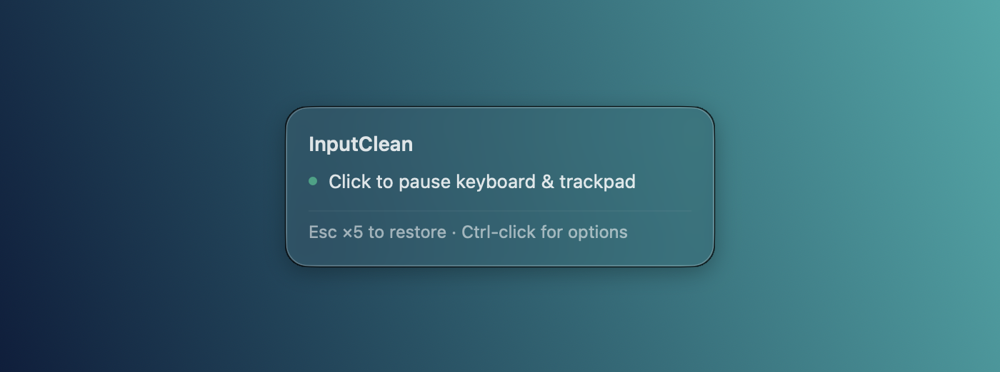
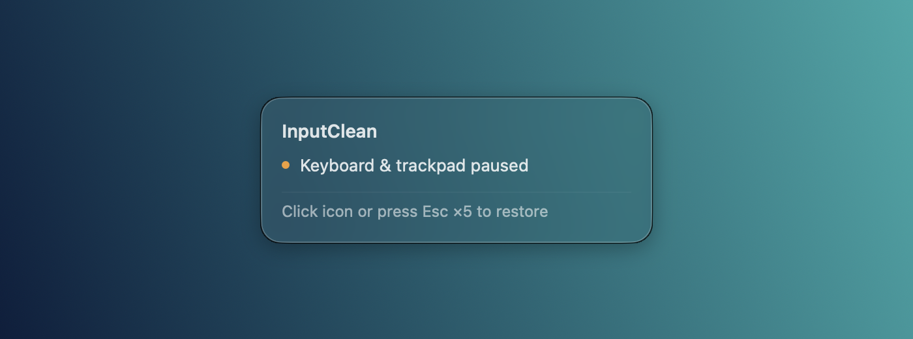

# InputClean

<p align="center"></p>

A small native macOS menu bar app for cleaning your trackpad, keyboard, or both without accidental input.

[Download InputClean for Apple Silicon](https://github.com/Nexace/InputClean/releases/download/v1.1.0/InputClean-macOS-arm64.zip) · [Releases](https://github.com/Nexace/InputClean/releases)

**One click pauses both keyboard and trackpad. Five separate Esc presses restore them.**



Screenshots show the real native macOS views over an app-owned gradient background. The screenshot helper previews states without blocking input.

## Use

1. Put InputClean in Applications and open it.
2. Grant **System Settings → Privacy & Security → Accessibility** access when prompted.
3. **Click the icon to pause both keyboard and trackpad.** Control-click (or right-click) for keyboard-only or trackpad-only cleaning.
4. Restore input with **five separate Esc presses**, or click the icon using an external mouse. In keyboard-only mode, the trackpad also remains usable.

You can also keep the app in a project folder and open it there. Reopen that same copy when changing Accessibility permissions.

Keep consecutive Esc presses within 1.5 seconds of each other. Holding Esc does not count; another key resets the sequence. A five-minute safety timeout also restores input.

External mouse events pass through unchanged, preserving macOS sensitivity and acceleration. The hover card explicitly says that clicking pauses keyboard and trackpad. The Control-click menu also provides Restore input and Quit.

Keyboard cleaning blocks ordinary keys, modifiers, and media controls from all keyboards. Power/Touch ID and controls reserved by macOS are outside the app's control. This is a temporary cleaning tool, not a security lock.

The app uses one process and has no network code, telemetry, or resident helper. Cleaning mode is temporary; it does not change trackpad preferences.

## Controls and modes

| Action | Result |
| --- | --- |
| Click the icon while ready | Pause keyboard and trackpad together |
| Click while any cleaning mode is active | Restore input |
| Control-click or right-click | Open the mode menu |
| Press Esc five separate times | Restore input |
| Wait five minutes | Safety timeout restores input |
| Lock the screen or quit the app | End the cleaning session |



| Mode | Keyboard | Trackpad | Recognized external mouse |
| --- | --- | --- | --- |
| Clean both, the icon default | Paused; Esc recovery remains available | Paused | Works normally |
| Clean keyboard | Paused; Esc recovery remains available | Works normally | Works normally |
| Clean trackpad | Works normally; Esc recovery remains available | Paused | Works normally |

Selecting a single-device mode from the menu starts that session. After restoring input, the next plain icon click starts **both**, regardless of the last menu choice.


## Permissions and troubleshooting

- **Accessibility** is needed for the temporary system-wide input filter. The normal app does not need Screen Recording access.
- If the card says **Allow Accessibility access**, enable the exact InputClean copy you are running, then click again.
- If you want keyboard-only or trackpad-only cleaning, **hold Control while clicking** the icon. A plain click always pauses both.
- If a mouse driver is not recognized, use five Esc presses to restore input. Mouse identification depends on macOS device metadata.
- Downloaded builds are ad hoc signed and are not Apple-notarized. Building from source is available below; rebuilding can require renewed Accessibility approval.

## Open at Login

After installing in Applications, enable the native macOS login item with:

```sh
/Applications/InputClean.app/Contents/MacOS/InputClean --enable-login
```

Manage it later in **System Settings → General → Login Items & Extensions**.

The same executable accepts `--disable-login` and `--login-status`. Login startup is optional and is not enabled by the build script.

## Build and check

Requires Xcode command line tools with the macOS 26 SDK or newer. The supplied app is built for Apple Silicon; the source builds for the host Mac's architecture. Minimum runtime macOS is 12; native login registration requires macOS 13 or later.

```sh
./build.sh
./test.sh
./profile.sh
```

The build is ad hoc signed, without Apple notarization. Rebuilding changes its signing hash, so macOS may require Accessibility access to be enabled again for an updated development build.

Tests cover the five-Esc sequence, held keys, interrupted sequences, timeouts, mode-specific keyboard filtering, pointer/gesture types, byte-for-byte preservation of native mouse events, the combined plain-click default after recovery, custom menu modes, activation after tracking ends, card layout, accessibility text, and view cleanup.

`tools/draw-icon.m` retains the native CoreGraphics source for the app icon.

The source was tested on Apple Silicon running macOS 27.0.1. The macOS 12 minimum is the declared deployment target; the earlier-system visual fallback has not been physically checked on those OS versions.

## RAM and CPU

Measurements use physical footprint, kernel lifetime peak, and process CPU time. CPU percentages use one core as 100%. Values are machine and macOS specific.

| UI stress phase | Current RAM | Lifetime peak | Average CPU |
| --- | ---: | ---: | ---: |
| Initial idle, 10 seconds | 8.27 MB | 8.42 MB | 0.006% |
| 30 hover cycles | 11.42 MB | 11.78 MB | 0.191% |
| Five menu openings | 12.85 MB | 12.93 MB | 0.219% |
| Post-use idle, 10 seconds | 12.42 MB | 12.93 MB | 0.002% |

Raw UI stress measurements are in [ui-performance.json](ui-performance.json). These are from the UI harness using the same application code; [live-performance.json](live-performance.json) records the separately launched app. MB means decimal megabytes. The 7 MB RAM target remains unmet.

The live acceptance session used a normal app process with no debugger attached. After real keyboard, trackpad, and mouse use, RAM settled at **15.91 MB**, with a **16.76 MB** lifetime peak. CPU averaged **0.0006%** over the following 88.7-second idle observation; the largest half-second CPU sample during interaction was **0.316%** of one core. All three modes, native mouse behavior, the mode menu, and five-Esc recovery were physically confirmed. The final combined plain-click default and explicit hover caption are covered by automated checks.

The saved live record separates interaction samples from post-use idle samples. Its historical pointer-mask flag identifies pointer filtering only; exact per-mode CPU/RAM is not inferred. The current sampler records any enabled app-owned input tap, avoiding that mask ambiguity.

The card uses native Clear Liquid Glass on macOS 26+, with a translucent popover fallback on earlier systems. One IOSurface draws the system typography. Temporary surfaces and the window are released on dismissal; a local event wakes AppKit to drain deferred window resources. A space-efficient allocator reduces retained heap memory. There is no repeating cursor polling timer.

To record a live session, run `./profile-live.sh APP_PID`, exercise the desired modes, leave the app idle for at least ten seconds, then press Control-C to finish. The sampler records every half-second and also stops when the app exits or after ten minutes. Its `cleaning` field is 1 when an enabled app-owned input tap is present and 0 when none is present; it does not guess the selected mode.

## Implementation and compatibility

The event filter runs only during cleaning. Trackpad movement is confined to the last allowed cursor position and its events are suppressed. Recognized external mouse events are returned unchanged. Temporary event-tap interruptions are resumed when macOS permits it.

Menu selections start the input filter after AppKit has left the menu tracking loop. The menu can start a single-device session; the icon's normal click always starts combined cleaning or restores an active session.

The click type and Control modifier are captured before closing the hover card, so closing transient UI cannot change which action the icon performs. Control-click also opens the mode menu when a trackpad's secondary click is unavailable.

Device routing uses undocumented CGEvent sender field 87 and public IORegistry metadata. This technique is described in [Mac Mouse Fix's device attribution code](https://github.com/noah-nuebling/mac-mouse-fix/blob/master/Helper/Utility/EventUtility.m); no source code from that project is included. Unknown pointing-device sources are suppressed, so some mouse drivers or automation-generated pointer events may also be blocked. Five Esc presses remain available for recovery. Browser and accessibility automation can still act directly, while synthetic keyboard/pointer events may be filtered. Switch cleaning mode off before using computer-control automation.

Developer diagnostics are opt-in with `INPUTCLEAN_DIAGNOSTICS=1`. They record selected modes, device sender IDs and aggregate blocked/passed counts, with no keystrokes or pointer coordinates.

## Project files

| File | Purpose |
| --- | --- |
| `main.m` | Menu bar UI, native cards, mode handling, input filter and optional login registration |
| `Info.plist`, `build.sh` | App bundle configuration and native build/signing |
| `check.m`, `tests/ui-check.m` | Logic, mouse-preservation, mode-routing and UI checks |
| `profile.sh`, `profile-live.sh`, `tests/` | Repeatable UI stress and live process measurements |
| `tools/draw-icon.m` | Reproducible keyboard/trackpad/cursor icon |
| `tools/screenshots.m`, `tools/capture-screenshots.py` | Real native UI photo capture over a controlled backdrop |
| `assets/` | README screenshots |
| `graphify-out/` | Source relationship graph and extraction audit |

To regenerate the README photos on macOS 14+:

```sh
python3 tools/capture-screenshots.py
```

This developer tool needs Screen Recording access for its calling Terminal or Codex process. It captures only the preview window's rectangle; it does not add that permission to the shipping app.

## Remove the app

If you enabled Open at Login, disable it in System Settings first. Choose **Quit InputClean** from its mode menu, then move its Applications copy to Trash. Keeping the source folder and its built app is optional; neither runs in the background once the app is closed.
