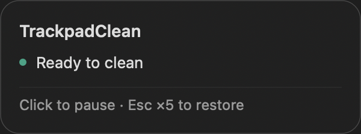

# TrackpadClean

A small native macOS menu bar app for cleaning your trackpad, keyboard, or both without accidental input.



## Use

1. Put TrackpadClean in Applications and open it.
2. Grant **System Settings → Privacy & Security → Accessibility** access when prompted.
3. Click the trackpad/sparkle icon to clean the trackpad, or right-click and choose **Clean keyboard** or **Clean both**.
4. Restore input with **five separate Esc presses**, or click the icon using an external mouse. In keyboard-only mode, the trackpad also remains usable.

Keep consecutive Esc presses within 1.5 seconds of each other. Holding Esc does not count; another key resets the sequence. A five-minute safety timeout also restores input.

External mouse events pass through unchanged, preserving macOS sensitivity and acceleration. Hover over the icon for the translucent status card. The right-click menu also provides Restore input and Quit.

Keyboard cleaning blocks ordinary keys, modifiers, and media controls from all keyboards. Power/Touch ID and controls reserved by macOS are outside the app's control. This is a temporary cleaning tool, not a security lock.

The app uses one process and has no network code, telemetry, or resident helper. Cleaning mode is temporary; it does not change trackpad preferences.

## Open at Login

After installing in Applications, enable the native macOS login item with:

```sh
/Applications/TrackpadClean.app/Contents/MacOS/TrackpadClean --enable-login
```

Manage it later in **System Settings → General → Login Items & Extensions**.

The same executable accepts `--disable-login` and `--login-status`. Login startup is optional and is not enabled by the build script.

## Build and check

Requires Xcode command line tools with the macOS 26 SDK or newer. The supplied app is built for Apple Silicon; the source builds for the host Mac's architecture. Minimum runtime macOS is 12; native login registration requires macOS 13 or later.

```sh
./build.sh
./test.sh
./profile.sh
```

The build is ad hoc signed, without Apple notarization. Rebuilding changes its signing hash, so macOS may require Accessibility access to be enabled again for an updated development build.

Tests cover the five-Esc sequence, held keys, interrupted sequences, timeouts, mode-specific keyboard filtering, pointer/gesture types, byte-for-byte preservation of native mouse events, menu options, card layout, accessibility text, and view cleanup.

`tools/draw-icon.m` retains the native CoreGraphics source for the app icon.

## RAM and CPU

Measurements use physical footprint, kernel lifetime peak, and process CPU time. CPU percentages use one core as 100%. Values are machine and macOS specific.

| UI stress phase | Current RAM | Lifetime peak | Average CPU |
| --- | ---: | ---: | ---: |
| Initial idle, 10 seconds | 8.31 MB | 8.42 MB | 0.006% |
| 30 hover cycles | 11.40 MB | 11.62 MB | 0.189% |
| Five menu openings | 12.53 MB | 12.96 MB | 0.233% |
| Post-use idle, 10 seconds | 12.17 MB | 12.96 MB | 0.002% |

Raw UI stress measurements are in [ui-performance.json](ui-performance.json). These are from the UI harness using the same application code; [live-performance.json](live-performance.json) records the separately launched app. MB means decimal megabytes. The 7 MB RAM target remains unmet.

A ten-minute observation of the launched app ended at 10.88 MB, with a 10.90 MB lifetime peak. No cleaning mode was activated during that observation, so it does not establish CPU or RAM usage while cleaning. Trackpad blocking, mouse sensitivity, and recovery were physically checked during development. The new keyboard and combined modes pass automated callback checks; their physical confirmation remains pending.

The card uses native Clear Liquid Glass on macOS 26+, with a translucent popover fallback on earlier systems. One IOSurface draws the system typography. Temporary surfaces and the window are released on dismissal; a local event wakes AppKit to drain deferred window resources. A space-efficient allocator reduces retained heap memory. There is no repeating cursor polling timer.

To record a live session, run `./profile-live.sh APP_PID`, test all three cleaning modes, then leave the app idle for ten seconds. The sampler records every half-second and stops after all modes and the final idle period, or after ten minutes. In its JSON, `cleaning` is 0 for idle, 1 for trackpad, 2 for keyboard, and 3 for both.

## Implementation and compatibility

The event filter runs only during cleaning. Trackpad movement is confined to the last allowed cursor position and its events are suppressed. Recognized external mouse events are returned unchanged. Temporary event-tap interruptions are resumed when macOS permits it.

Device routing uses undocumented CGEvent sender field 87 and public IORegistry metadata. This technique is described in [Mac Mouse Fix's device attribution code](https://github.com/noah-nuebling/mac-mouse-fix/blob/master/Helper/Utility/EventUtility.m); no source code from that project is included. Unknown pointing-device sources are suppressed, so some mouse drivers or automation-generated pointer events may also be blocked. Five Esc presses remain available for recovery. Browser and accessibility automation can still act directly, while synthetic keyboard/pointer events may be filtered. Switch cleaning mode off before using computer-control automation.

Developer diagnostics are opt-in with `TRACKPADCLEAN_DIAGNOSTICS=1`. They record device sender IDs and aggregate blocked/passed counts, with no keystrokes or pointer coordinates.
